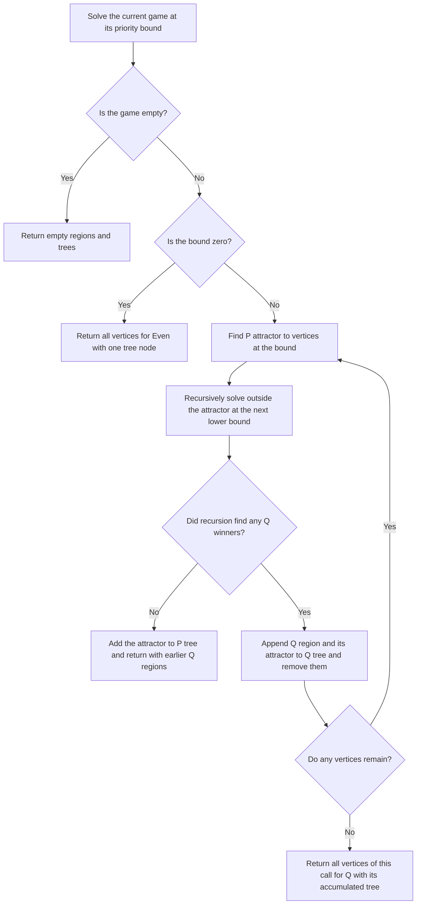
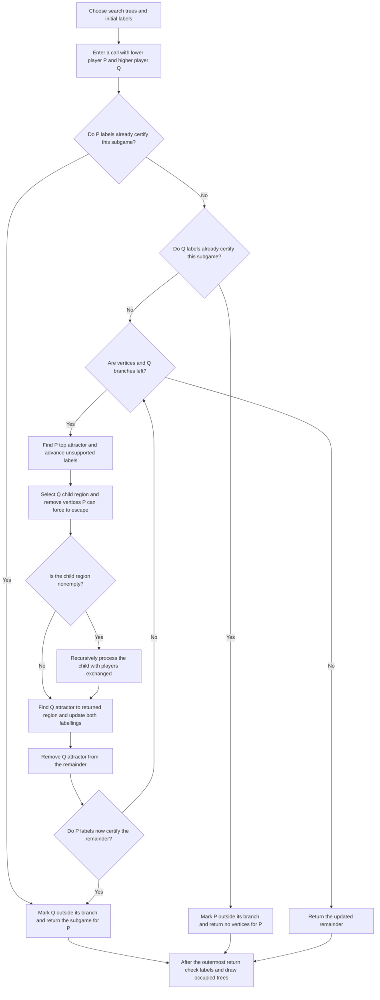
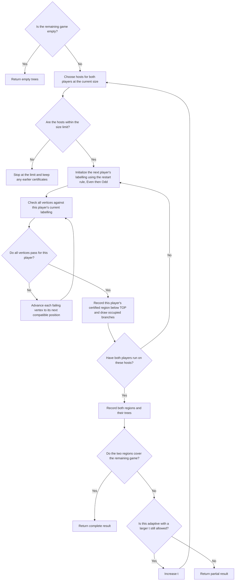
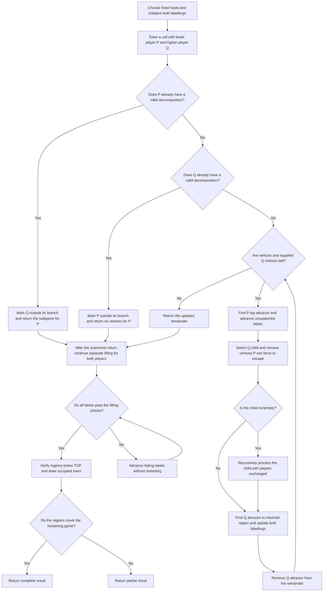
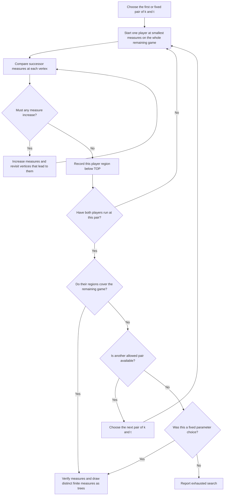
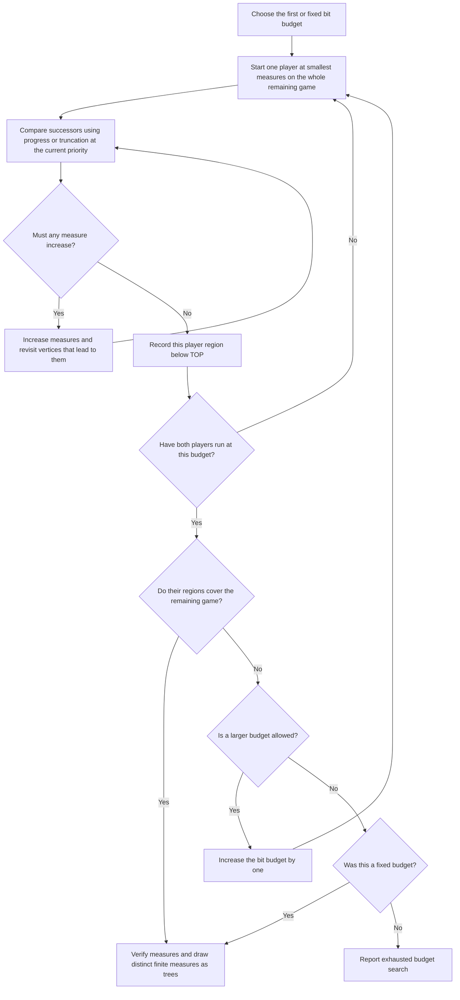

# How the trees are built

A parity game is a directed graph whose vertices have an owner, Even or Odd,
and an integer priority. Play follows edges forever; the owner of the current
vertex chooses the next move. Even wants the largest priority visited
infinitely often to be even. Odd wants it to be odd.

A winning region contains the vertices from which a player can force a win.
An attractor to a target is the set from which that player can force play to
reach the target. A decomposition tree records how a winning region breaks
into smaller regions and their attractors. A progress-measure tree groups
vertices by their final progress labels, with shared leading parts of labels
forming shared branches.

[DECOMP.md](DECOMP.md) shows example trees with these metrics:

| Metric | Meaning |
| --- | --- |
| `nodes` | Number of nodes in the result tree. Several game vertices can belong to one tree node. |
| `leaves` | Number of tree nodes with no children. |
| `internal_nodes` | Number of tree nodes with at least one child. |
| `height` | Number of nodes on the longest path from the root to a leaf. |
| `width` | Largest number of nodes on one level. |
| `max_arity` | Largest number of children of one node. |
| `mean_internal_arity` | Mean number of children over internal nodes; zero if there are none. |
| `branching_nodes` | Number of tree nodes with at least two children. |
| `min_leaf_depth` | Fewest nodes on a path from the root to a leaf. |
| `mean_leaf_depth` | Mean number of nodes on a path from the root to a leaf, over all leaves. |
| `strahler` | A leaf has value 1. At an internal node, take the largest child value and add 1 if at least two children share that largest value. The tree's value is the root's value. |

Each tree's `.metrics` file has one line per field, with `even=` and `odd=`
values. Depth counts nodes from the root (depth 1); means have three decimal
places. An empty tree has zero for every metric. Metrics cover only the final
round, excluding connector boxes, shaved regions and unresolved vertices.
Progress-measure trees include an extra root, so their depths, heights and node
counts have a different meaning from those of decomposition trees.

Each player's Strahler number is the smallest Strahler number among that
player's attractor decompositions; the game's Strahler number is the larger of
the two. For a complete result without shaving, the larger of the reported Even
and Odd values is an upper bound for the game's.
With shaving or partial results, the metrics describe only the represented
part of the remaining game (after preprocessing and earlier shaving rounds).

## Preprocessing and shaving

The `+pre` rows run `--initial-shave=all --compress` before the selected solver:

1. Compress priority gaps and merge consecutive distinct priorities of the
   same parity, preserving winners. Choose the levels from the full input
   and keep them fixed throughout shaving.
2. Shave simple winning regions in this order: the whole remainder if its
   priorities have one parity; winning self-loops whose owner matches their
   priority's parity or whose loop is the only remaining move; cycles whose
   vertices are all owned by one player and whose highest priority has that
   player's parity. Remove each region's attractor too, Even before Odd.
   Repeat until a full pass removes nothing.
3. Run the solver on the remainder. If nothing remains, the result is
   complete with empty trees.

The `+iter` rows add `--iter-shave`, available only for lifting-based backends,
including progress measures:

1. Run lifting until the labels stabilise. Take the certified dominions:
   regions where a player can keep play inside and force a win.
2. Remove those dominions and their attractors, recording their winners.
3. Retry on the remainder. Fixed host bounds stay the same; adaptive lifting advances
   to the next t, keeping the initial remainder's host bounds.

Progress measures process Even's dominion and attractor before running Odd on
the remainder.

Removing a dominion's attractor leaves a subgame whose winners remain winners
in the full game. Exits into one's own removed region are winning; vertices
where the opponent could force an exit into its region were already attracted
out.

Adaptive solvers use the priority and size bounds left by initial preprocessing.
Compression and shaving can lower these bounds, allowing lower t values and
smaller hosts. Iterative shaving reduces the game searched in later rounds.
The `+pre+iter` rows combine both steps. Won counts all rounds and their
attractors once per vertex; tree metrics and parameters describe only the
final round, excluding earlier certificates and attracted vertices.

Source: [Oink, TACAS 2018](https://arxiv.org/abs/1801.03859), trivial dominions and priority compression.

## Zielonka: `zielonka`

Zielonka builds complete decomposition trees by recursively solving smaller
games and removing winning regions. It appends regions in removal order and
reuses the final recursive tree, so its tree can differ from a lifting result.

1. Start with the remaining game and its highest priority bound. In any
   recursive call, an empty game returns empty trees. At bound zero, Even
   wins the whole current game and gets a one-node tree.
2. Call the player matching the current bound's parity P and the other
   player Q. Find P's attractor to the vertices at that bound.
3. Set that attractor aside and recursively solve the rest at the next lower
   priority bound.
4. If the recursive result has no Q winners, P wins the whole current
   remainder. Add the attractor to P's returned tree, creating a root if
   needed, and return it together with any Q regions removed earlier.
5. Otherwise, find Q's attractor to the Q region just returned. Append that
   region, its attractor and its recursive tree to Q's accumulating tree.
   Remove the attractor and return to step 2 at the same bound. If nothing
   remains, return the accumulated Q tree for the whole game of this call.

Source: [Raghavan's thesis](https://thejaswiniraghavan.github.io/PhD_Thesis.pdf), Algorithm 7.

`pg2adot --trace=steps.jsonl` records the steps of all four decomposition
algorithms, including both players' intermediate H/T/S labels, recursive calls,
attractors and lifting rounds. Tracing preserves the computed result and statistics.
The file uses JSON Lines (`strahler-trace/1`); `--trace-limit=N` stops with status
1 and a final `truncated` event when N events have been written (default one
million). The event schema is in [the command reference](docs/developing.md#algorithm-traces).

## Symmetric Zielonka: `zielonka-sym`

Symmetric Zielonka builds complete decomposition trees and keeps both players'
search labels across recursive calls. Those labels can settle a remaining
subgame before all search branches have been visited.

1. Give each player a search tree with enough branches for the whole game.
   Place each vertex at the earliest position allowed by its priority.
   Positions can be inside a branch or just outside it. The roots have
   consecutive priority bounds, one of each parity. The higher bound is
   above the game's priorities, so its top attractor is empty; advance
   labels that require this missing attractor.
2. In a recursive call, let P be the player with the lower priority bound
   and Q the other player. Test whether P's remembered labels already give
   a valid decomposition of the current subgame; if so, return that subgame
   for P. Otherwise test Q and, if valid, return no vertices for P. On either
   return, mark the losing player's labels outside its current branch.
3. If neither test succeeds, visit Q's search branches in order. Find P's
   attractor to vertices at P's current bound. Advance P's labels whose
   required top attractor is missing. Mark attractor vertices still inside
   the Q branch being examined as outside that branch.
4. Take the vertices still inside that Q branch. Remove any from which P
   can force an escape from this candidate, advancing their Q labels too.
   This leaves a subgame in which P cannot force an exit. If it is nonempty,
   recursively repeat the procedure there with the players and bounds
   exchanged.
5. Find Q's attractor to the Q region returned by that call, or to the empty
   set if there was no call. Advance Q's branch-boundary labels outside this
   attractor. Mark attracted vertices still inside P's current branch as
   outside it, then remove the attractor from the current remainder.
6. Test P's remembered decomposition of the remainder again. If it is valid,
   mark Q's remaining labels outside its branch and stop this call. Otherwise
   continue with the next Q branch while vertices remain. Return the updated
   remainder to the caller. After the outermost call, check both players'
   labels and draw the occupied branches as the two result trees.

Source: [Raghavan's thesis](https://thejaswiniraghavan.github.io/PhD_Thesis.pdf), Algorithm 8, with the entry correction and child-region closure explained in [the symmetric analysis](docs/symmetric.md).

## Attractor-decomposition lifting: `lifting` and `lifting-adaptive`

Lifting finds decomposition trees by repeatedly advancing vertex labels
within a host, a search tree with room for candidate decompositions.
`lifting` uses one host per player; `lifting-adaptive` tries a sequence of
hosts, starting small.

1. If the remaining game is empty, return empty trees. Otherwise choose a
   host for each player. In a Strahler host, H counts node levels according
   to the priority bounds, K bounds its Strahler number, and t controls its
   size allowance. The default `lifting` hosts are large enough to cover
   every winning region.
   Alternatives can restrict K, fix the number of children, or supply a
   chosen tree shape, and may leave vertices unresolved.
2. For `lifting-adaptive`, start t at the smaller of the chosen starting
   value (zero by default) and the game-size bound. Let K grow with t up to
   the height and any chosen cap. Increase t only up to the game-size bound.
   Stop if a host would exceed the allowed size; an adaptive search can keep
   earlier certificates once both players have run.
3. Immediately before each player's search, start each vertex at its earliest
   priority-compatible position in that player's host. There are also
   intermediate positions between branches and an outside position called
   TOP. The incremental-t choice starts already certified opponent wins at
   TOP, including wins just found at the current t, and restarts all other
   labels at their earliest positions.
   It keeps the full game and all its edges; its result at each host is
   identical to an ordinary restart.
4. Check every vertex against the same current labelling. At an ordinary
   tree position, a vertex owned by the player needs one successor before
   the end of that position's subtree; an opponent-owned vertex needs all
   successors there. At an intermediate position, the player must be able
   to force an earlier label while staying at or before the current position.
   An opponent move outside that safe range counts as an escape. TOP always
   passes the check.
5. Advance every failing vertex to its next priority-compatible position.
   Repeat steps 4 and 5 until all vertices pass. Run this search separately
   for Even, then Odd, on the whole remaining game.
6. For each player, the vertices below TOP form a certified winning region.
   Turn the occupied host positions into a decomposition and discard empty
   branches. The displayed tree and its metrics cover only the occupied host
   positions.
7. Stop with a complete result when the two regions cover the remaining
   game. Otherwise, an adaptive run tries the next host and repeats from
   step 3, remembering the first t at which each player's largest region was
   found. A fixed host or an exhausted capped search returns a partial
   result. Successive adaptive hosts need not contain one another, and a
   player's region can shrink at a later t; earlier certificates remain
   sound.

Source: [Raghavan's thesis](https://thejaswiniraghavan.github.io/PhD_Thesis.pdf), Algorithm 5 and Proposition 7.2.1, using repeated short lifts; see [the incremental analysis](docs/incremental-t.md) for the incremental-t choice.

## Symmetric lifting: `lifting-sym`

Symmetric lifting lets the two players' decomposition searches guide each other
within a fixed pair of hosts. It retains labels through recursion and finishes
with separate lifting passes to certify the winning regions.

1. Choose one fixed host per player, using the host choices described for
   `lifting`. Initialize both labellings at their earliest compatible
   positions and advance the higher root's unsupported labels. This method
   does not use an adaptive sequence of hosts.
2. Enter the player-swapping recursion described for `zielonka-sym`. First
   test P's current decomposition, then Q's. A successful test ends that
   call with the corresponding region and moves the other player's labels
   outside its current branch.
3. Otherwise, visit Q's available child branches in order. Compute P's top
   attractor and advance unsupported labels. Select the part still inside
   Q's child and remove vertices from which P can force an escape, updating
   their Q labels.
4. Recursively process a nonempty child with the players exchanged. Compute
   Q's attractor to the returned region, advance unsupported branch-boundary
   labels, move attracted vertices outside P's branch, and remove the
   attractor from the current remainder.
5. Continue until the remainder is empty or the supplied children are
   exhausted, then return the remainder to the caller. There is no extra
   remembered-decomposition stopping test after each child. The outermost
   return gives a separator used by the search; winning regions still need
   certification.
6. Continue the ordinary `lifting` validity checks and label advances for
   each player, starting from the labels just obtained. Repeat until all
   labels pass, then verify the winning regions below TOP and draw their
   occupied trees. Universal hosts give complete results; smaller hosts can
   leave unresolved vertices.

Source: [Raghavan's thesis](https://thejaswiniraghavan.github.io/PhD_Thesis.pdf), Algorithm 9 and Section 8.3, with the corrections described in [the symmetric analysis](docs/symmetric.md).

## Strahler progress-measure lifting: `pm-strahler`

Strahler progress-measure lifting assigns measures to vertices and draws the
tree of distinct final measures. The search varies the allowed Strahler number
and a size allowance. Its result is a different kind of tree from a decomposition.

1. Start the search at k equal to 1 and t equal to 1. Here k bounds the
   candidate measure tree's Strahler number and t supplies its size allowance.
   A fixed choice tries just that pair. An empty game has no measures.
2. For each player separately, start at the smallest measure on the whole
   remaining game. The measure has components for priorities of the other
   player's parity; depth counts these levels, including empty intervening
   ones. Cap k at one more than that player's depth. Measures beyond the
   current allowance become TOP, meaning this run has not certified a win.
3. Examine the measures reached by each outgoing move, comparing only the
   components relevant to the current priority. Require progress at a
   priority of the other player's parity. At a vertex owned by the player
   being tested, choose the smallest required successor measure; at an
   opponent-owned vertex, use the largest.
4. Increase the vertex's measure only when that comparison requires it.
   Retain lower-priority parts of the stored measure even when a comparison
   ignores them. Revisit vertices that can move to a changed vertex and
   continue until no measure needs to increase.
5. The vertices below TOP are certified wins for that player. Once both
   players have run, stop if their regions cover the remaining game.
   Otherwise try another allowed pair of k and t. Consider increasing k
   before increasing t, ranking choices by the ratio of the larger value
   to the smaller, rounded down. Keep within the game-size and depth bounds;
   a fixed choice can return a partial result. Exhausting the automatic
   search without covering the game reports an error.
6. Verify the measures' progress and the winning regions. Draw each distinct
   finite measure as a leaf, join shared leading components into branches,
   and include an extra root. Attach game vertices to their final measures.

Source: [The Strahler Number of a Parity Game](https://arxiv.org/abs/2003.08627); the search schedule follows Oink.

## Succinct progress-measure lifting: `pm-succinct`

Succinct lifting builds a tree from distinct progress measures with a total
bit budget shared across their components. The search increases that budget
instead of varying the Strahler method's two parameters.

1. Start with a budget of one bit, using zero for a game with at most one
   vertex, or use the chosen fixed budget. The bits value in the inventory
   is this total budget per measure, shared across its components.
2. For each player separately, initialize the smallest measures on the whole
   remaining game. Components correspond to priorities of the other player's
   parity, with depth counting those levels. TOP marks vertices that the
   current budget does not certify for this player.
3. At each vertex, compare the successor measures at the current priority.
   At the other player's priorities, require progress; at the tested
   player's priorities, discard the lower-priority components. This differs
   from `pm-strahler`, which retains those parts in its stored measures.
   Choose the smallest required successor value at the tested player's
   vertices and the largest at the opponent's vertices.
4. Increase a measure when required and revisit vertices that can move to
   it. Repeat until no measure changes, for both players independently.
5. If the two regions below TOP cover the remaining game, stop. Otherwise
   increase the bit budget by one and restart both searches, up to the
   game-size bound. A fixed budget returns the wins certified by that run
   and leaves any other vertices unresolved. Exhausting the automatic
   budget search without covering the game reports an error.
6. Verify progress and the winning regions, then draw the distinct finite
   measures as ordered trees with shared leading components and an extra
   root, as for `pm-strahler`.

Source: [Succinct progress measures for solving parity games](https://arxiv.org/abs/1702.05051); the budget schedule follows Oink.
